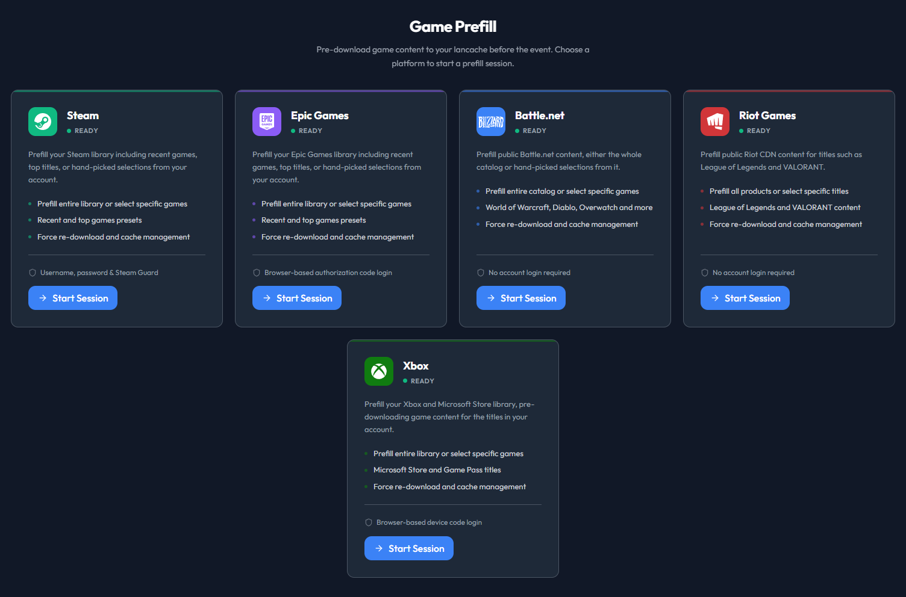

# Prefill { #prefill-steam--epic }

Prefill downloads games into your cache *before* people connect. When guests show up, every install reads from your cache instead of the public internet - full LAN speed, no bandwidth bottleneck.

Steam, Epic, Battle.net, Riot, and Xbox each run in their own container, so you can prefill all of them at the same time without them interfering. Progress streams live to the UI.

<div align="center" markdown>


<em>Pick a platform to start a prefill session</em>
</div>

### Requirements

- Docker socket mounted (`/var/run/docker.sock`)
- Signed in to LANCache Manager as **Primary** or **Account** (**Guest Mode** can prefill only on platforms granted in **Guest Defaults**)
- Your cache server is reachable from the prefill container (see [Network setup](#prefill-network) below)
- For Xbox specifically, a container-based lancache. Bare-metal has no Xbox Live log, so its downloads stay invisible to the manager - see [Bare-Metal LANCache](bare-metal-lancache.md#bare-metal)

### Running a prefill

The flow is the same on every platform:

1. Open the **Prefill** tab and click **Start Session** on **Steam**, **Epic Games**, **Battle.net**, **Riot Games**, or **Xbox**
2. Sign in where the platform asks for it: username, password, and Steam Guard for Steam; **Open Epic sign-in page**, paste the **Authorization Code**, then **Submit code**; **Open Microsoft page** and enter **Your code** there for Xbox. Battle.net and Riot need no account
3. Click **Select Apps**
4. Click **Prefill Selected**, then **Start Download**

That's it. Leave it running - when guests arrive, everything's cached.

!!! note
    Prefill builds on community daemons:

    - **Steam**: [steam-prefill-daemon](https://github.com/regix1/steam-prefill-daemon), a fork of [steam-lancache-prefill](https://github.com/tpill90/steam-lancache-prefill) by [@tpill90](https://github.com/tpill90)
    - **Epic**: [epic-prefill-daemon](https://github.com/regix1/epic-prefill-daemon) - sign in at Epic, then paste the **Authorization Code**
    - **Battle.net**: [battlenet-prefill-daemon](https://github.com/regix1/battlenet-prefill-daemon) - fully anonymous, no account needed
    - **Riot**: [riot-prefill-daemon](https://github.com/regix1/riot-prefill-daemon), built on [@tpill90](https://github.com/tpill90)'s lancache-prefill tools - fully anonymous; covers League of Legends and Valorant
    - **Xbox**: [xbox-prefill-daemon](https://github.com/regix1/xbox-prefill-daemon) - signs in with a Microsoft device code (account required, like Epic)

### Importing Steam App IDs

Have a list of App IDs from `steam-lancache-prefill` or somewhere else? Skip the library browser:

1. Click **Select Apps**
2. Click **Import App IDs**
3. Paste your IDs in any of these formats:
   - Comma-separated: `730, 570, 440`
   - JSON array: `[730, 570, 440]`
   - One per line
4. Click **Import**

The dialog tells you how many games were added, how many were already selected, and how many IDs aren't in your Steam library (those aren't added to your selection).

!!! tip
    **Coming from `steam-lancache-prefill`?** Open `selectedAppsToPrefill.json` and paste the contents straight into the import field - the JSON array is parsed as-is.

### Scheduled Prefill { #scheduled-prefill }

Set this up once and stop prefilling by hand before every event. Go to **Management → Schedules** and open the Scheduled Prefill card. The card has **Run all** and an **Actions** menu. **Run all** starts the enabled saved schedules. **Actions** opens **View activity** and **Container settings**.

Each service lists its saved schedules as separate rows. **Run schedule** on a row starts only that schedule. **Edit schedule** opens that record. Save, close the editor, then use **Run schedule**. A run uses the saved schedule.

**Add schedule** and **Duplicate** both open a draft. They do not create a schedule until you choose **Save**. Deleting a saved schedule does not stop its service container or remove cached games.

Each service has one shared container for all of its schedules. **Start** starts it, and **Manage** is where you sign in. A scheduled run reuses that container only when it is already running. If Steam, Epic, or Xbox has no running signed-in container, that service is skipped and the notice says it needs login, while other services continue. Battle.net and Riot need no account, but they are skipped too when their container is not running. A tick where nothing ran is reported unsuccessful, with the reason in its notification. A skip does not fail a tick in which another service did run.

**Container settings** holds the defaults for every service container, including **Login**. A saved **After a restart** override still wins for that service. **Clear stored logins** signs out running containers and removes saved Steam, Epic, and Xbox logins. Only the LANCache account that saved one of those logins can reuse it.

**View activity** covers Steam, Epic, Xbox, Battle.net, and Riot in one view. It shows active downloads and run history, and it lets you cancel an active download. Game selection belongs to the exact saved schedule. To delete cached game content, use **Game Cache Detection and Removal** under **Management → Logs & Cache**. Deleting a schedule does not delete cached games.

Other schedule behavior remains service-specific:

- **Intervals and state.** Every saved schedule has its own "run every" interval. You can pause a schedule or set it to run only on startup. The first automatic run is one interval after you save; saving does not start a run.
- **Presets or hand-picked games.** Presets are **All**, **Recent**, and **Top**. Epic has no Recent because its API exposes no last-played data. Battle.net and Riot are All-only. Games selected for a schedule override its preset.
- **New schedule history.** "Last run: Never" remains until that saved schedule finishes its first run. Its next run is predicted from its interval.
- **Target platforms.** Only Steam supports the Windows, Linux, and macOS depot filter. Windows is the default.
- **Download controls.** Force re-download is off by default. Connections can be **Auto** or **Fixed** from 1 through 256. Run notifications are **All runs**, **Manual only**, **Silent**, or **Hidden**.

Defaults and limits:

| Setting | Default |
|---|---|
| Run every (per schedule) | 24 hours |
| Preset | All (Top uses the top 50 games) |
| Persistent login validity | 90 days |
| No-progress cutoff (per scheduled run) | 30 minutes |
| Force download | Off |
| Max concurrency | Auto (fixed: 1-256) |
| Longest single service run | 12 hours |

The rest of the Schedules page works the same way for every background service - log rotation, eviction scans, game detection, cache snapshots, and more. Each service is a row with its own interval and a run control at the end. There's an **Xbox Game Mapping** row too, so the Xbox catalog can refresh on its own schedule.

### Network setup { #prefill-network }

**Most installs need zero config.** If you run the standard `lancache` + `lancache-dns` containers, lancache-manager auto-detects them and prefill works without further setup.

If your DNS isn't a stock `lancache-dns` (you use AdGuard Home, Pi-hole, public DNS, etc.) or your routing is unusual, set one env var and you're done:

| Your setup | What to set |
|---|---|
| Stock `lancache` + `lancache-dns` containers | nothing |
| Single-box install (lancache on the same host as lancache-manager) | nothing |
| AdGuard Home, Pi-hole, or any DNS replacement | `Prefill__LancacheIp=<your-cache-ip>` |
| Host networking, host's DNS doesn't route CDN to your cache | usually nothing - the cache is auto-detected via the bridge gateway and heartbeat-verified; set `Prefill__LancacheIp=<your-cache-ip>` if the network panel still warns |
| Caddy/Squid/non-nginx cache that routes by `Host:` header | `Prefill__LancacheIp=<your-cache-ip>` |
| You want predictable behavior regardless of environment | always set `Prefill__LancacheIp` |

!!! tip
    **`Prefill__LancacheIp` is the universal override.** When set, prefill talks to your cache by IP and never asks DNS where the cache lives. Network mode and DNS server settings stop mattering for CDN traffic.

Full descriptions and defaults for `Prefill__LancacheIp`, `Prefill__LancacheDnsIp`, and `Prefill__NetworkMode` live in the [Configuration → Prefill](configuration-reference.md#prefill-config) reference table.

!!! important
    **`LancacheIp` and `LancacheDnsIp` are different services, even on the same machine.**

    | | What it is | Port | Job |
    |---|---|---|---|
    | `LancacheIp` | The **cache server** (`lancachenet/monolithic`, or any HTTP cache) | HTTP / 80 | Holds the actual cached game files |
    | `LancacheDnsIp` | The **DNS server** (`lancachenet/lancache-dns`, AdGuard Home, Pi-hole, etc.) | DNS / 53 | Translates `lancache.steamcontent.com` into the cache's IP |

    Think of a small town: the **cache** is the library where the books live, and the **DNS server** is the information booth you ask for directions. They can share a building (same IP, different ports) but they do different jobs. Setting `LancacheIp` walks straight to the library, which is why DNS stops mattering for cache traffic.

!!! important
    `LANCACHE_IP` only redirects CDN chunk traffic, which is all lancache caches anyway. Steam (`api.steampowered.com`) and Epic (`*.epicgames.com`) auth and manifest endpoints still use normal DNS, and are unaffected.

#### Examples

**Most reliable** - `LancacheIp` makes CDN routing DNS-independent:

```yaml
environment:
  - Prefill__NetworkMode=host
  - Prefill__LancacheIp=192.168.1.10
```

**Bridge mode with a non-standard DNS** (e.g., AdGuard Home replacing lancache-dns):

```yaml
environment:
  - Prefill__NetworkMode=bridge
  - Prefill__LancacheIp=192.168.1.10        # cache server
  - Prefill__LancacheDnsIp=192.168.1.20     # DNS server
```

**Bridge mode, stock lancache-dns, no IP override** (legacy DNS-driven path):

```yaml
environment:
  - Prefill__NetworkMode=bridge
  - Prefill__LancacheDnsIp=192.168.1.20
```

!!! tip
    **Prefill container has no internet?** Try `Prefill__NetworkMode=bridge`.

#### Network diagnostics

Each prefill session runs a connectivity test on startup and writes the result to logs:

```
═══════════════════════════════════════════════════════════════════════
  PREFILL CONTAINER NETWORK DIAGNOSTICS - prefill-daemon-abc123
═══════════════════════════════════════════════════════════════════════
  Internet connectivity: OK (reached api.steampowered.com)
  lancache.steamcontent.com resolved to 192.168.1.10
  DNS looks correct (private IP - likely your lancache server)
═══════════════════════════════════════════════════════════════════════
```

If the resolved IP is a public address (Steam's real CDN IPs look like `162.254.x.x`), traffic is bypassing your cache. Set `Prefill__LancacheIp` and restart the session.

??? tip "How routing works (advanced) — which path a request takes"

    ```mermaid
    ---
    config:
      flowchart:
        curve: basis
        padding: 12
    ---
    flowchart TD
      Start([Need a game chunk<br/>from a CDN hostname])
      HasIp{LANCACHE_IP available?<br/>Prefill__LancacheIp or<br/>auto-detected + verified}

      Start --> HasIp

      HasIp -->|yes| Direct[Talk to that IP directly<br/>Host header = CDN name]
      Direct --> Hit([Served from your cache])

      HasIp -->|no| AskDns[Ask DNS where the<br/>CDN hostname points]
      AskDns --> Mode{NetworkMode?}

      Mode -->|host| HostDns[Use the host machine DNS<br/>Prefill__LancacheDnsIp is ignored]
      Mode -->|bridge| Bridge{Prefill__LancacheDnsIp set?}

      Bridge -->|yes| Forced[Query that DNS server]
      Bridge -->|no| Probe[Daemon probes CDN name,<br/>localhost, then gateway]

      HostDns --> Resolved{DNS returned<br/>your cache IP?}
      Forced --> Resolved
      Probe --> Resolved

      Resolved -->|yes| Hit
      Resolved -->|no| Miss([Public CDN IP<br/>traffic skips your cache])
    ```

    Every combination:

    | `NetworkMode` | `LancacheIp` | `LancacheDnsIp` | Outcome |
    |:---:|:---:|:---:|---|
    | `host` | set | (any) | Reliable. `LANCACHE_IP` injected; DNS irrelevant. |
    | `host` | unset | (any) | Usually fine. Auto-detect + heartbeat injects `LANCACHE_IP`; otherwise host DNS is used. DnsIp is dropped in host mode. |
    | `bridge` | set | unset | Reliable. `LANCACHE_IP` injected; DNS irrelevant. |
    | `bridge` | set | set | Reliable. `LANCACHE_IP` for CDN, DnsIp for auth/manifest. |
    | `bridge` | unset | set | Works if DnsIp resolves CDN to your cache. |
    | `bridge` | unset | unset | Usually fine. Auto-detect injects `LANCACHE_IP`; otherwise the daemon probes localhost/gateway. |

    **Why `LancacheIp` always works:** with it set, the daemon requests `GET http://192.168.1.10/depot/...` with `Host: lancache.steamcontent.com`. Your cache routes on `Host:` and serves from cache. DNS is never asked for the CDN domain.

-----
